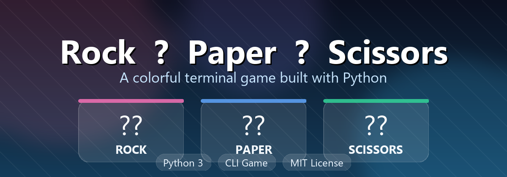
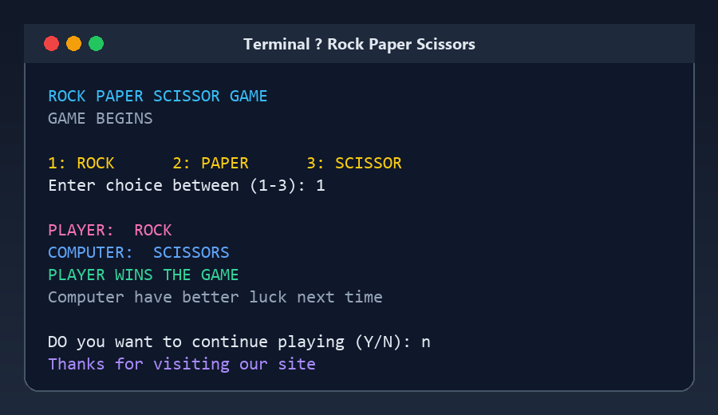

<p align="center">
  
</p>

<p align="center">
  <b>A colorful, beginner-friendly Rock • Paper • Scissors terminal game built with Python.</b>
</p>

<p align="center">
  
  
  
  
</p>

<p align="center">
  Play against the computer, test your luck, and enjoy quick rounds right from your terminal.
</p>

---

## ✨ Highlights

- 🎮 **Interactive gameplay** — simple menu-driven Rock, Paper, Scissors experience
- 🤖 **Computer opponent** — random move generation every round
- 🧠 **Instant results** — clear win, lose, or tie feedback
- 🔁 **Replay support** — play again without restarting the program
- 🐍 **Pure Python** — uses only the built-in `random` module

## 🖼️ Gameplay Preview

<p align="center">
  
</p>

## 🚀 Getting Started

### Prerequisites

- Python **3.6+**
- No external libraries required

### Run locally

```bash
# 1. Clone the repository
git clone https://github.com/sarveshkamdi7-collab/rock-paper-scissors-game.git

# 2. Move into the project folder
cd rock-paper-scissors-game

# 3. Start the game
python rock_paper_scissors.py
```

## 🕹️ How to Play

1. Launch the game.
2. Choose your move:
   - `1` → Rock
   - `2` → Paper
   - `3` → Scissors
3. The computer picks its move randomly.
4. See the round result instantly.
5. Enter `y` to continue or `n` to exit.

## 📜 Game Rules

| Your Move | Beats |
|:---------:|:-----:|
| 🪨 Rock   | Scissors |
| 📄 Paper  | Rock |
| ✂️ Scissors | Paper |

> If both players choose the same move, the round ends in a **tie**.

## 📂 Project Structure

```text
rock-paper-scissors-game/
├── assets/
│   ├── banner.png
│   └── gameplay.png
├── LICENSE
├── README.md
├── _.gitignore
└── rock_paper_scissors.py
```

## 🛠️ Built With

- **Python** — core game logic
- **random** — computer move selection
- **Terminal UI** — emoji-styled prompts and messages

## 🔮 Future Improvements

- Display a running score summary across rounds
- Add stronger input handling for non-numeric choices
- Add best-of-3 / best-of-5 mode
- Improve replay prompt flexibility

## 📄 License

This project is licensed under the **[MIT License](LICENSE)**.

## 👤 Author

**[sarveshkamdi7-collab](https://github.com/sarveshkamdi7-collab)**

<p align="center">
  <sub>Made with Python and a love for classic games.</sub>
</p>
